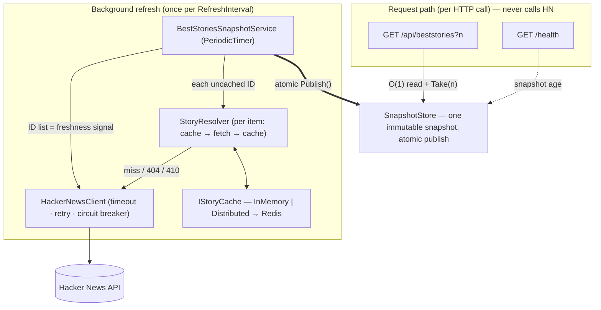

# Hacker News Best Stories

An ASP.NET Core minimal API that returns the best `n` Hacker News stories ordered by score. A background service refreshes an immutable snapshot, so requests read local state in constant time and never wait on Hacker News.

## Quickstart

The .NET 10 SDK is required.

```bash
dotnet run --project src/HackerNews.BestStories.Api
curl 'http://localhost:8080/api/beststories?n=5'
```

The interactive [Scalar API reference](http://localhost:8080/scalar/v1) is available in every environment.

Docker is an alternative:

```bash
docker build -t hackernews-beststories .
docker run --rm -p 8080:8080 hackernews-beststories
```

To run the API with a Redis-backed story cache instead of the process-local default:

```bash
docker compose up --build
curl 'http://localhost:8080/api/beststories?n=5'
```

## Configuration

Configuration can be overridden with standard ASP.NET Core configuration providers, including environment variables such as `Snapshot__RefreshInterval`.

| Key | Default | Meaning |
| --- | --- | --- |
| `Snapshot:RefreshInterval` | `00:01:00` | Fixed period between refresh starts after the initial build; a slow refresh is immediately followed by the next pending tick. |
| `Snapshot:InitialFetchAwaitTimeout` | `00:00:30` | Maximum request wait for the first successful snapshot. |
| `Snapshot:FetchParallelism` | `16` | Maximum concurrent item resolutions during a refresh. |
| `Cache:Provider` | `InMemory` | Story-cache implementation: `InMemory` (process-local, default; pinned in `appsettings.Development.json` for development) or `Distributed` (Redis-backed; requires `ConnectionStrings:Redis`, see "Story cache"). |
| `Cache:ItemTtl` | `00:02:00` | Absolute lifetime from writing an available item; cache reads do not extend it. |
| `Cache:NegativeTtl` | `00:00:30` | Absolute lifetime from writing an unavailable item; cache reads do not extend it. |
| `Resilience:AttemptTimeout` | `00:00:05` | Timeout for one HTTP attempt. |
| `Resilience:TotalTimeout` | `00:00:30` | Timeout for the complete resilient HTTP operation. |
| `Resilience:RetryCount` | `2` | Retries after the initial attempt (1–100). |
| `Resilience:CircuitBreakerFailureRatio` | `0.5` | Failure ratio that opens the circuit. |
| `Resilience:CircuitBreakerSamplingWindow` | `00:10:00` | Window used to calculate the circuit-breaker failure ratio. |
| `Resilience:CircuitBreakerBreakDuration` | `00:00:30` | Time an open circuit rejects calls before probing again. |
| `Resilience:CircuitBreakerMinimumThroughput` | `50` | Minimum sampled calls before the circuit can open. |

`IStoryCache.GetAsync` returns one explicit state—miss, story, or unavailable—so a negative hit cannot be confused with a cache miss.

### Story cache providers

- `InMemory` — default; stores object references in a process-local `IMemoryCache`. Selected explicitly for development in `appsettings.Development.json`.
- `Distributed` — serializes entries into a Redis-backed `IDistributedCache`. Selecting it registers the Redis backend from `ConnectionStrings:Redis` automatically; a missing connection string fails at startup with a clear error.

`docker compose up --build` runs the API with `Cache__Provider=Distributed` and `ConnectionStrings__Redis=redis:6379` next to a `redis:7-alpine` container; the story entries are visible with `docker compose exec redis redis-cli keys 'hacker-news:*'`.

Tests or other single-process hosts can substitute a different `IDistributedCache` backend by registering it after `AddStoryCache`; `AddDistributedMemoryCache()` keeps the backend process-local.

## Tests

Run the full gate from the repository root:

```bash
dotnet build -warnaserror
dotnet format --verify-no-changes
dotnet test
```

The tests use fixture payloads and an in-process fake upstream. The same build, formatting, and test checks can be run locally with the commands above.

## Health

`GET /health` returns HTTP 200 with `status: "Healthy"` and `snapshotAgeSeconds`. The age is the non-negative number of seconds since the last snapshot publication, or `null` before the first publication. It measures snapshot age, not the age of cached story details. The endpoint remains healthy while serving stale data after an upstream failure.

## Design overview

Data comes from the [Hacker News Firebase API](https://github.com/HackerNews/API).



The request path performs one atomic snapshot-reference read, making it O(1) before serializing the requested results; it never calls Hacker News. `BestStoriesSnapshotService` starts immediately, fetches the uncached ID list as the freshness signal, resolves distinct items with bounded concurrency, and publishes a score-descending immutable snapshot. `SnapshotStore` also gates cold-start requests and timestamps publications through `TimeProvider`.

Story details are cached behind a DI-selected `IStoryCache`. Available entries and negative entries use separate TTLs; null items, deleted/dead items, and HTTP 404/410 responses are negatively cached. The standard HTTP resilience chain applies per-attempt and total timeouts, two jittered retries, and a circuit breaker; 404/410 responses are typed as unavailable and are not retried.

The ID list is fetched once per refresh, with starts governed by `RefreshInterval`. If the ID-list call fails, the last snapshot remains available; if one item fails transiently, its previous value is retained when possible.

With the shipped one-minute refresh interval and two-minute item TTL, a warm cycle costs one ID-list call. Expired items are fetched again at the next refresh, producing a full item re-fetch burst roughly every `ItemTtl` for a stable list. For about 200 available IDs, the nominal two-refresh pattern is one call on the warm cycle and about 201 on the expiry cycle: roughly 101 upstream calls per minute on average, before retries. Fetch duration and expiry relative to refresh ticks affect the exact timing. Request volume does not add upstream calls; item freshness depends on both the TTL and refresh schedule, and failures can keep data stale longer.

The snapshot itself is process-local. Multiple instances can share story entries by selecting `Distributed`, but they still build and publish independent snapshots.

## Assumptions

- `n` is required and must be a positive 32-bit integer; missing, malformed, overflowing, or non-positive values return 400.
- If `n` exceeds the available story count, every available story is returned.
- Link-less posts use `https://news.ycombinator.com/item?id={id}` as their URI.
- Deleted, dead, unavailable, or incomplete items are excluded.
- A null `descendants` value maps to `commentCount: 0`.
- Stories are ordered by score descending, then by ID descending.
- Data can lag Hacker News by up to `RefreshInterval`; item details can additionally lag by `ItemTtl`.

## Enhancements given more time

- Coordinate distributed snapshots with leader election or a distributed lock.
- Add idle-stop backoff when the upstream list is unchanged.
- Stagger item expiry to spread re-fetch bursts across refresh cycles.
- Publish OpenTelemetry metrics for refreshes, cache outcomes, snapshot age, and resilience events.
- Add rate limiting at the public API boundary.
- Introduce explicit API versioning before evolving the response contract.
